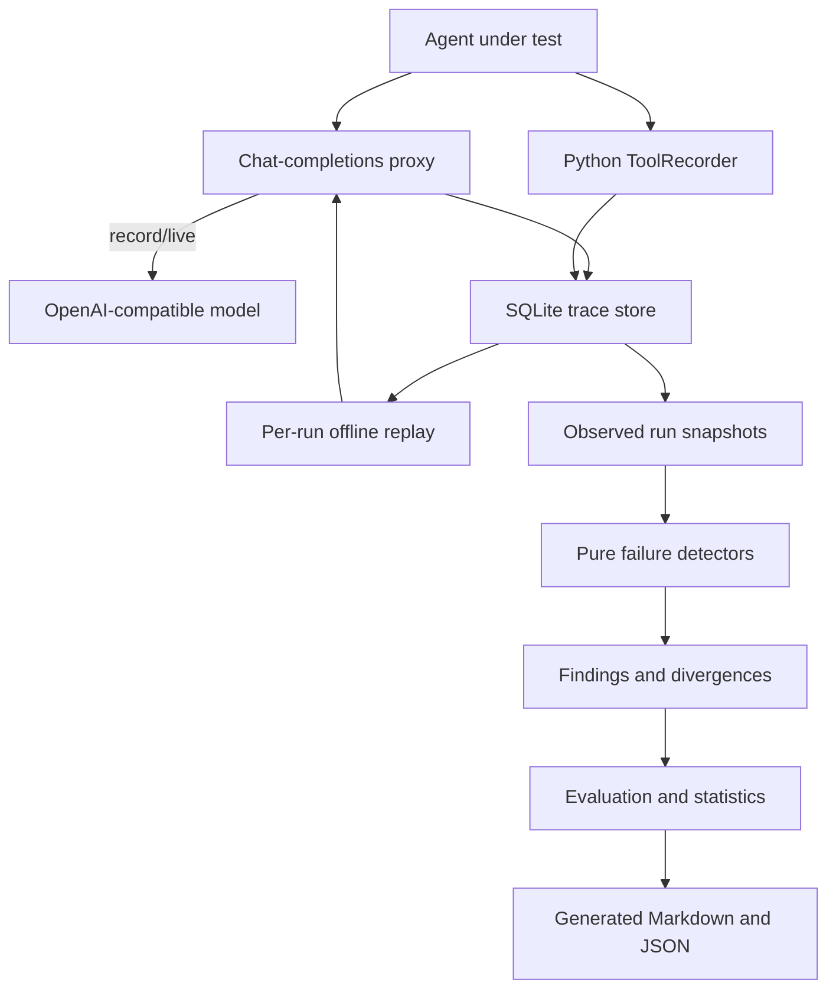

# AgentReplay

Record an AI agent's LLM traffic and Python tool executions, then replay them offline to catch behavioral regressions in CI. Recording uses an OpenAI-compatible model; replay and development need no GPU or model credentials.

Strict matching checks model, messages, tools, and sampling parameters. Lenient matching checks messages and tools. A changed request, extra tool call, reordered exchange, or unused recording produces a structured divergence with request differences.

## Quickstart

Run from a checkout with Python 3.10–3.12, Git, and access to PyPI for installation. The following commands use only checked-in recordings after installation. Start with unused `demo.db` and `exported.jsonl` paths.

```bash
python3 -m venv .venv
source .venv/bin/activate
python -m pip install '.[dev]'
ruff check .
pytest -q
agentreplay check --golden tests/golden --agent examples.minimal_agent:run_agent
agentreplay import --db demo.db --in tests/golden/minimal-add.jsonl
agentreplay list --db demo.db
agentreplay show --db demo.db --trace-id minimal-add
agentreplay export --db demo.db --trace-id minimal-add --out exported.jsonl
cmp tests/golden/minimal-add.jsonl exported.jsonl
```

The golden check prints a JSON report and exits 0 for the unchanged agent, 1 for a divergence or error finding, and 2 for configuration errors. It executes the agent through an in-process replay proxy; replay tools return stored values without executing the real tool. The round trip preserves the exported bytes.

To record your own agent against an existing model endpoint:

```bash
agentreplay record --db recording.db --name smoke --upstream http://127.0.0.1:8000 --port 9000
```

Point its chat-completions client at `http://127.0.0.1:9000/v1`. Use `ToolRecorder` in the agent process to capture Python tool calls; HTTP capture alone does not capture tools. See [the minimal agent](examples/minimal_agent.py) and [its integration example](tests/integration/test_minimal_agent.py). Stop the recording server, run `agentreplay list --db recording.db`, then replay the returned trace ID:

```bash
agentreplay replay --db recording.db --trace-id TRACE_ID --mode strict --port 9000
```

## Architecture



[Design](docs/DESIGN.md) describes matching, storage, streams, faults, and independent detector scoring. [Milestone history](docs/MILESTONES.md) preserves implementation details and API examples. [Live-run guide](docs/LIVE_RUN.md) covers configuration, resume, backup, and manual labeling.

## Results (preliminary; owner review pending)

Qwen/Qwen3-8B, 200 frozen tasks across five environments, three trials per version. These rows are copied verbatim from the generated [live report](reports/summary.md); complete detector counts, confidence intervals, model revision, code SHA, and environment are recorded there.

| Metric | Value | Success count | n | 95% interval |
|---|---:|---:|---:|---|
| versions.v1.task_success | 0.768333 | 461 | 600 | [0.732932, 0.800320] |
| versions.v1.tool_call_validity | 1.000000 | 1247 | 1247 | [0.996929, 1.000000] |
| versions.v1.loop | 0.000000 | 0 | 600 | [0.000000, 0.006362] |
| versions.v1.timeout | 0.000000 | 0 | 600 | [0.000000, 0.006362] |
| versions.v1.mean_steps | 2.160000 | — | 600 | undefined |
| versions.v2.task_success | 0.490000 | 294 | 600 | [0.450191, 0.529936] |
| versions.v2.tool_call_validity | 1.000000 | 1253 | 1253 | [0.996944, 1.000000] |
| versions.v2.loop | 0.000000 | 0 | 600 | [0.000000, 0.006362] |
| versions.v2.timeout | 0.000000 | 0 | 600 | [0.000000, 0.006362] |
| versions.v2.mean_steps | 2.165000 | — | 600 | undefined |
| replay_determinism | 1.000000 | 1200 | 1200 | [0.996809, 1.000000] |
| clean_false_positives.any | 0.000000 | 0 | 1510 | [0.000000, 0.002538] |
| regression_divergence | 0.325000 | 195 | 600 | [0.288739, 0.363488] |
| paired.success_difference | -0.278333 | — | 600 | [-0.315000, -0.243333] |

Repeat determinism compares two replays with each other, not with the original execution. The clean false-positive rate is conditional on successful, finding-free source runs. In the original M9 runner, natural tool errors could change the next replay request because the reference agent included the `ToolReplayedError` wrapper in its tool message. The original loop detector could find the loop but miss its injected target sequence (755 TP, 167 FP, 167 FN across 922 injected loop faults). These original measurements remain unchanged. The release-hardening branch normalizes replayed error text and associates repeated calls with a unique earlier matching execution; it never guesses among multiple matching executions or reads fault labels. Follow-up checks are documented in [release review](docs/RELEASE.md).

The owner must hand-solve 20 tasks in [REVIEW.md](src/agentreplay/evals/REVIEW.md) and blindly label the [100 selected natural runs](reports/live/manual-sample.json). Until then these results are not a validated benchmark and no significance claim is made. [Archive receipts](reports/live/README.md) document the verified local backup; raw trace data is kept outside Git.

Reproduce reports from the preserved working database:

```bash
agentreplay report --db results/live-review.db --out reports --evaluation-id b29dda4b8d1f4b5bb52be3ad7c91ea27
```

For a separate model-free demonstration, use fresh database/output paths:

```bash
agentreplay eval run --db offline.db --config examples/eval-offline.yaml
agentreplay report --db offline.db --out reports/local-offline
```

Do not interpret scripted-backend results as live model performance.

## Limitations

Given the same trace, the same agent code, and an agent that is deterministic given its inputs, replay produces identical outputs every time. AgentReplay does not make agent code deterministic.

- Agent code can depend on time, randomness, UUIDs, or unordered iteration; those can cause replay divergences. Live vLLM seeded sampling is best-effort.
- Local library and CLI only: no hosted service, web UI, authentication, or multi-tenancy.
- Only OpenAI-compatible `/v1/chat/completions` traffic is recorded. Native Anthropic/Gemini protocols, embedding/RAG endpoints, audio, images, `/v1/completions`, and `/v1/responses` are unsupported.
- Tool capture requires synchronous, in-process Python tools with JSON arguments/results. HTTP-based and non-Python tool capture are unsupported. Replayed errors use `ToolReplayedError(original_error_string)` rather than recreating arbitrary exception classes.
- Streaming preserves SSE data-line content and order, not transport byte boundaries, keepalive formatting, or timing. Replay never sleeps. Mid-stream failures retain partial data; replay appends `[DONE]` even for incomplete recordings.
- Traces contain request/response bodies and tool data that may be sensitive. Headers and API keys are not stored; automatic PII redaction is not implemented.
- SQLite schema 7 and `agentreplay.trace.v1` are frozen for this release series. Incompatible databases/exports are rejected explicitly; no migration tool is provided. Exported traces exclude run history, findings, and labels.
- Recording sequence allocation is coordinated within one shared store, not across independent processes. Replay consumption is isolated per run and must be shared between the proxy and tool recorder.
- Injected-fault labels and manual presence labels are separate evidence sources. Detectors cannot see injected labels. Correlated tasks/trials and repeats limit statistical generalization; 240 bad-result faults lack localized verification and remain unscored.

## Status and development

- [x] M1–M8 automated implementation: streams, tool replay, run isolation, portable traces, faults, detectors, 200 tasks, verifiers, evaluation, and statistics.
- [x] M9 live recordings and replay/fault evaluation; verified database and golden exports saved off the GPU.
- [ ] Owner review of 20 tasks and blind labels on 100 natural runs.
- [x] M10 clean-clone CI matrix (Python 3.10–3.12) and fresh Python 3.12 quickstart verified.
- [ ] Release-hardening fixes verified against archived traces and CI.
- [ ] Final release review and `v0.1.0` tag.

Development uses feature branches and pull requests. Run `make test`, `make lint`, and `make check-golden` before submitting changes. CI installs the package and runs the same offline checks on Python 3.10, 3.11, and 3.12; tests block real socket connections. Dependency installation itself requires network access. Only the dependencies declared in `pyproject.toml` are required; vLLM is external to the library.

M10 verification: **676 tests passed** locally and on each GitHub matrix version; Ruff, installed golden checks, and trace round trips passed. The quickstart was run verbatim from a clean checkout in a new Python 3.12 virtualenv. See the [CI run](https://github.com/Yaswanth2120/agentreplay/actions/runs/45072530092). The existing FastAPI/Starlette TestClient HTTPX deprecation warning is retained; no unapproved dependency was added.
